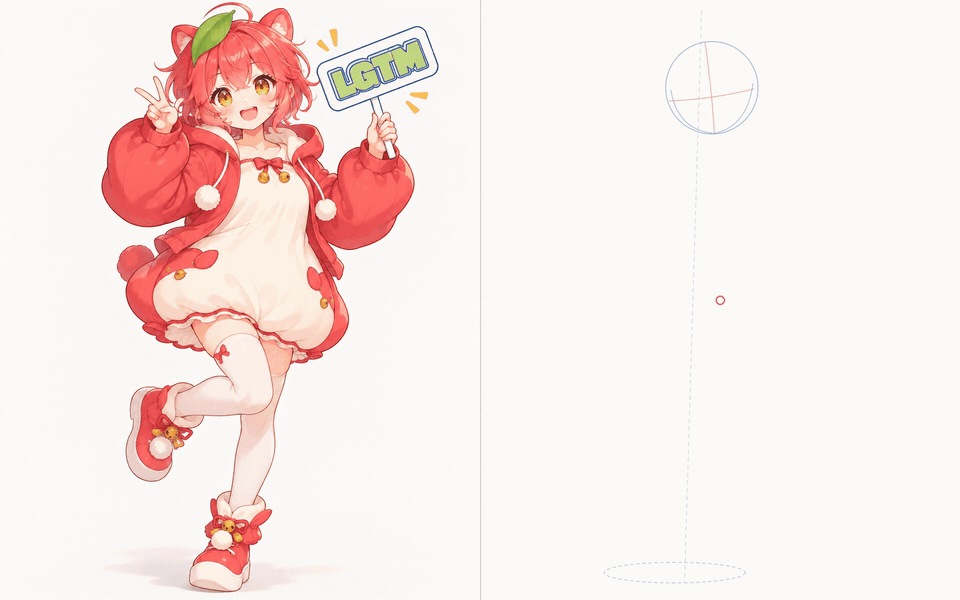
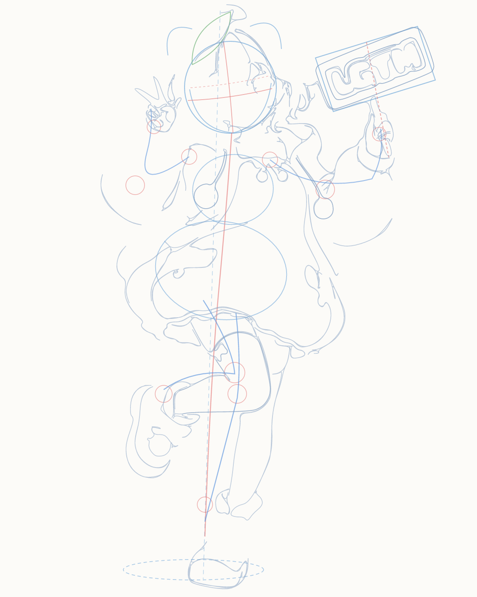
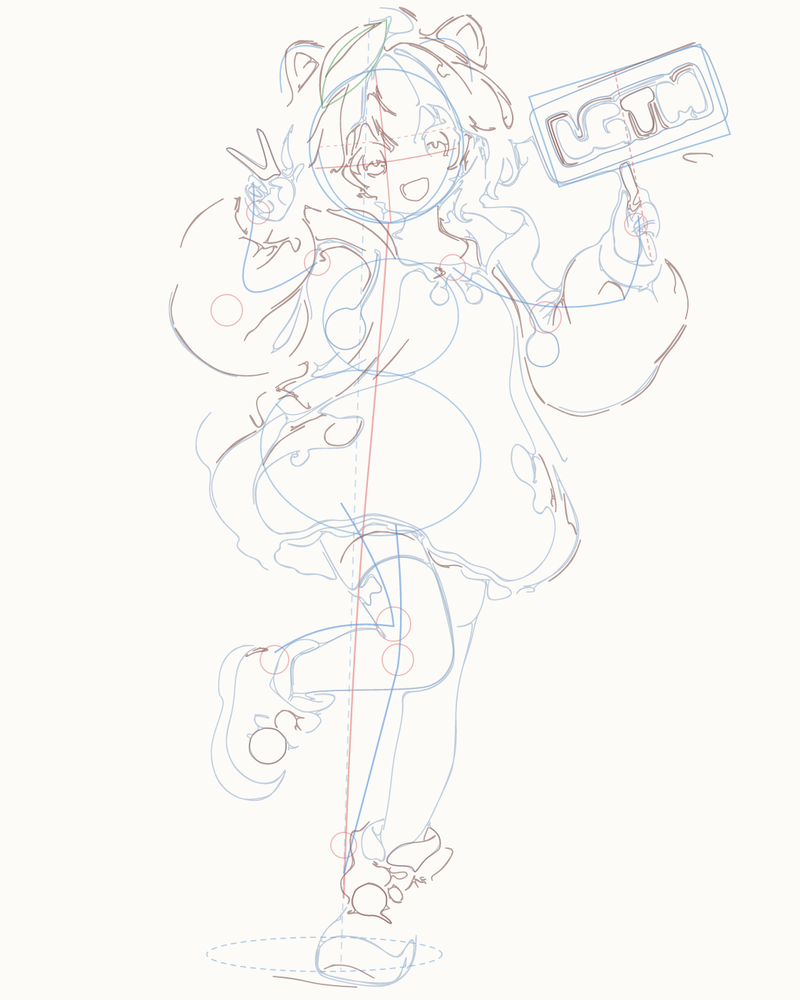
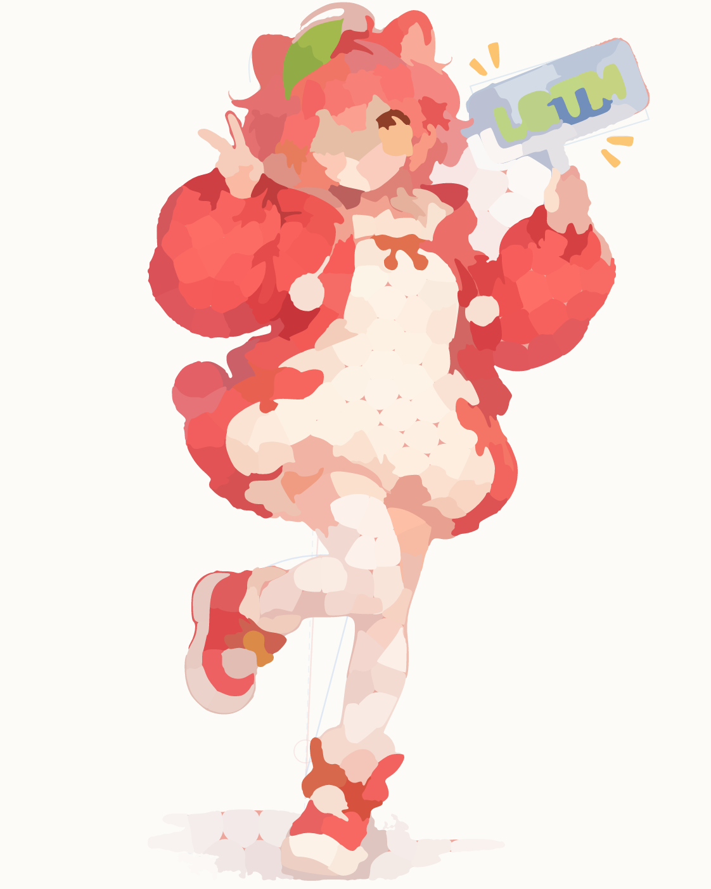
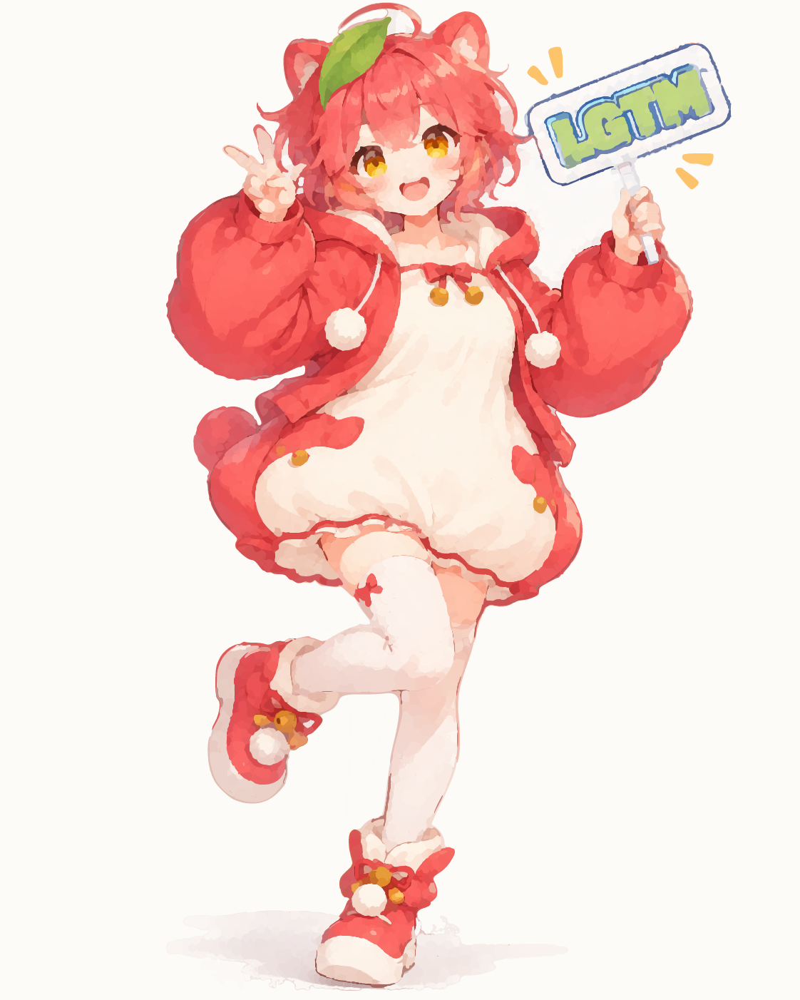

# An illustration, drawn in SVG from rough sketch to finish

I had Gemini 4 Argon turn one illustration into SVG. Paths are stacked the way a person draws: rough construction, flat color, shading, then the finish. The lines and the color are SVG elements. The clip below is that SVG being drawn, next to the original.

Left is the source illustration. Right is the SVG.



The finished SVG has **7,554** drawing elements on a 1122×1402 canvas. The rough construction lines stay in the file. In the final state their opacity is 0.

The GIF is a smaller loop of the comparison. The full-size files are [`output/drawing_process_full.mp4`](output/drawing_process_full.mp4) and [`output/drawing_process_full.webm`](output/drawing_process_full.webm).

## Prompt

This is the prompt I used. The reference illustration was attached.

```text
添付した参考画像をできる限り忠実かつ繊細なSVGとして再現し、元画像と描画過程を左右比較する動画も作成してください。

【描画プロセス】
人間が絵を描く自然な制作過程を再現すること：
1. ラフスケッチを描き、構図や比率を決める。
2. 大きな色面を配置し、明暗関係を構築する。
3. 構造、陰影、細部を段階的に描き込む。
4. 全体を確認し、修正・仕上げを行う。

【描画方法】
すべてを一度に描くのではなく、現在の描画状態を確認しながら、次に描く部分をバッチ単位で判断・追加して段階的に完成度を高めてください。要素数は増やしてできるだけ繊細にし、完成したSVGファイルと描画工程の比較動画を出力してください。
```

In English: reproduce the attached reference as a faithful, delicate SVG, and make a side-by-side video of the original and the drawing. Follow the way a person draws — rough sketch and proportion, large areas of color and light, then structure, shading, and detail, then a full check and finish. Do not draw it all at once. Look at the current state, choose the next part in batches, and raise the element count so the result is as delicate as possible. Output the finished SVG and the comparison video.

## The SVG

GitHub shows an SVG file as a still image, and the CSS animation does not run there. Save the file and open it in a browser to watch it draw.

- Animated SVG, about 24 seconds: [`output/lgtm_character_animated.svg`](output/lgtm_character_animated.svg) (2.9 MB)
- Finished SVG: [`output/lgtm_character_final.svg`](output/lgtm_character_final.svg) (2.6 MB)

To scrub element by element, compare against the original with a slider, or jump to a batch:

```bash
npm install
npm run dev
```

Open http://127.0.0.1:43123. The files in `public/` are the same set as `output/`, served by the viewer.

## Drawing order

Four stages, ten batches, in the order a person would draw. The counts are elements added in that batch, and the running total at the end of it. The running total includes one canvas background rectangle, so batch 1 adds 75 elements and the total is 76. Each stage is saved as `output/batches/batch_01.svg` through `batch_10.svg`.

### 1. Rough sketch: composition and proportion

<p>
  
  
</p>

| Batch | What gets drawn | Added | Total |
| --- | --- | ---: | ---: |
| 1 | Construction: head sphere, crosshairs, center of gravity, joints, sign perspective | 75 | 76 |
| 2 | Rough lines for the ears, leaf, hoodie, dress, and shoes | 98 | 174 |

### 2. Big color shapes, then light and shadow

<p>
  
  
</p>

| Batch | What gets drawn | Added | Total |
| --- | --- | ---: | ---: |
| 3 | Flat color for the hair, skin, red hoodie, white dress, and sign. The rough lines fade | 246 | 420 |
| 4 | Light from the upper left: cast shadow, the hoodie's volume, the legs | 519 | 939 |

### 3. Structure, shading, and detail

<p>
  
  
  
</p>

| Batch | What gets drawn | Added | Total |
| --- | --- | ---: | ---: |
| 5 | Hair overlap, hoodie folds, skirt gathers, knee-sock shading | 1,062 | 2,001 |
| 6 | Eyes, mouth, bells, ribbons, pompoms, the LGTM letters and frame | 1,383 | 3,384 |
| 7 | Hair strands, frills, midtone gradients | 1,450 | 4,834 |

### 4. Check the whole picture, then finish

<p>
  
  
  
</p>

| Batch | What gets drawn | Added | Total |
| --- | --- | ---: | ---: |
| 8 | Edges, second shadow, reflected light, fingertips, letter edges, contact shadow | 1,350 | 6,184 |
| 9 | Eyelashes, iris, bell highlights, LGTM outlines, colored line art | 702 | 6,886 |
| 10 | Eye highlights, hair shine, blush, sparkles on the sign | 668 | 7,554 |

Element counts and the difference from the original (MAE / PSNR) are in [`output/drawing_process_metadata.json`](output/drawing_process_metadata.json).

## Files

| Path | What it is |
| --- | --- |
| `output/drawing_process_full.gif` | Comparison loop used above. Left: original. Right: SVG being drawn |
| `output/drawing_process_full.mp4` | Same comparison, full size |
| `output/drawing_process_full.webm` | Same comparison, WebM |
| `output/lgtm_character_final.svg` | Finished SVG, including the rough-sketch layers |
| `output/lgtm_character_animated.svg` | The same elements, revealed over about 24 seconds with CSS |
| `output/lgtm_character_final.png` | Raster export of the finished SVG |
| `output/batches/batch_01.svg` … `batch_10.svg` | SVG and PNG at the end of each batch |
| `public/` | The same files, served by the viewer |
| `assets/` | The original illustration |
